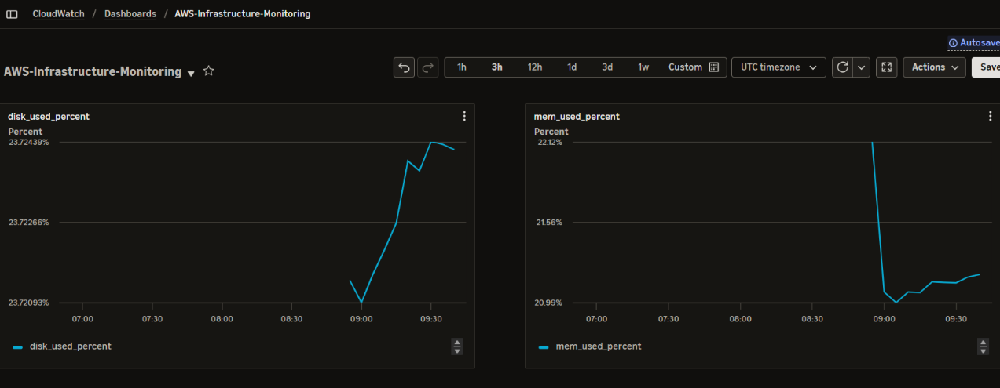
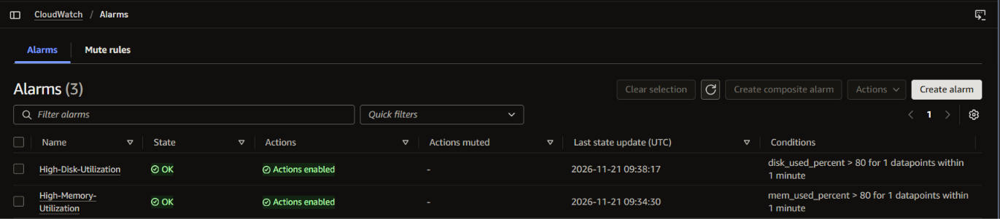
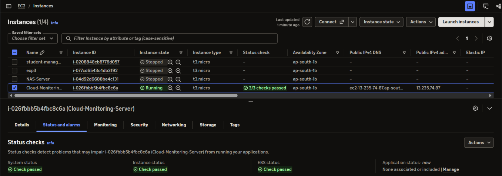

# AWS Infrastructure Monitoring & Alerting System

## Project Overview

This project implements an AWS-based infrastructure monitoring and alerting system to monitor EC2 instance resource utilization using Amazon CloudWatch.

The system collects memory and disk utilization metrics through the CloudWatch Agent, displays them in a centralized CloudWatch dashboard, and generates email notifications when resource utilization exceeds configured thresholds.

## Architecture

EC2 Instance → CloudWatch Agent → Amazon CloudWatch → CloudWatch Dashboard & Alarms → Amazon SNS Email Notifications

## AWS Services Used

- **Amazon EC2:** Hosted the Linux monitoring environment.
- **AWS IAM:** Provided secure permissions for CloudWatch metric publishing.
- **Amazon CloudWatch:** Collected and visualized infrastructure metrics.
- **CloudWatch Agent:** Collected system-level memory and disk utilization metrics.
- **Amazon SNS:** Delivered alarm notifications through email.

## Implementation

1. Launched an Amazon Linux 2023 EC2 instance.
2. Created and attached an IAM role with CloudWatch permissions.
3. Installed and configured the Amazon CloudWatch Agent.
4. Configured custom metrics with a 60-second collection interval.
5. Collected memory utilization (`mem_used_percent`) and disk utilization (`disk_used_percent`).
6. Created a CloudWatch dashboard to visualize both metrics.
7. Configured CloudWatch alarms with an 80% utilization threshold.
8. Integrated Amazon SNS to deliver email notifications.
9. Verified that both alarms reached the OK state.

## CloudWatch Agent Configuration

The CloudWatch Agent was configured to collect system-level metrics at 60-second intervals.

The configuration includes:
- Memory utilization: `mem_used_percent`
- Disk utilization: `used_percent`
- Filesystem monitored: `/`
- Custom namespace: `CloudMonitoringProject`

Configuration file: [cloudwatch-agent-config.json](cloudwatch-agent-config.json)

## Monitoring Configuration

|      Metric          | Threshold   | Monitoring Period |
| Memory Utilization   | Above 80%   |    1 minute       |
|  Disk Utilization    | Above 80%   |    1 minute       |

## Security Considerations

- Used IAM roles instead of storing AWS credentials in application files.
- Avoided publishing private keys, account identifiers, or sensitive configuration details.
- Used SNS email subscription confirmation for notification delivery.

## Cost Management

The EC2 instance was stopped after project implementation to reduce unnecessary compute costs.

Note: CloudWatch metrics, dashboards, alarms, SNS, and associated AWS resources may still incur charges depending on usage and applicable pricing.

## Key Learnings

- EC2 instance configuration and management.
- IAM roles and AWS permissions.
- CloudWatch Agent installation and configuration.
- Custom infrastructure metrics collection.
- CloudWatch dashboards and alarms.
- SNS email notification integration.
- Basic AWS monitoring and troubleshooting.

## Project Screenshots

### CloudWatch Monitoring Dashboard

### CloudWatch Alarms

### EC2 Instance

## Author

Hrishikesh V Hiremath
